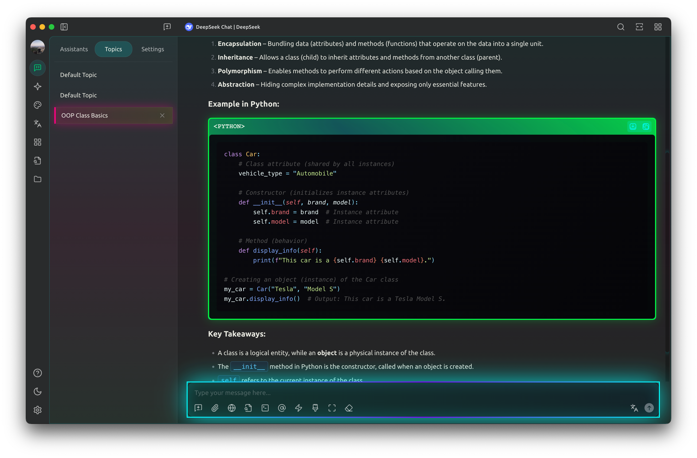
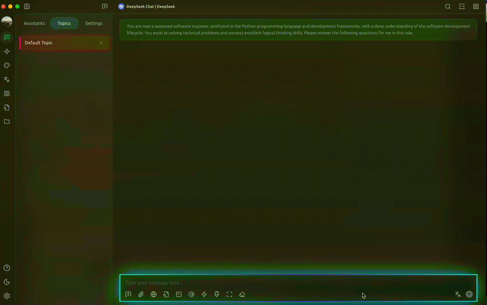
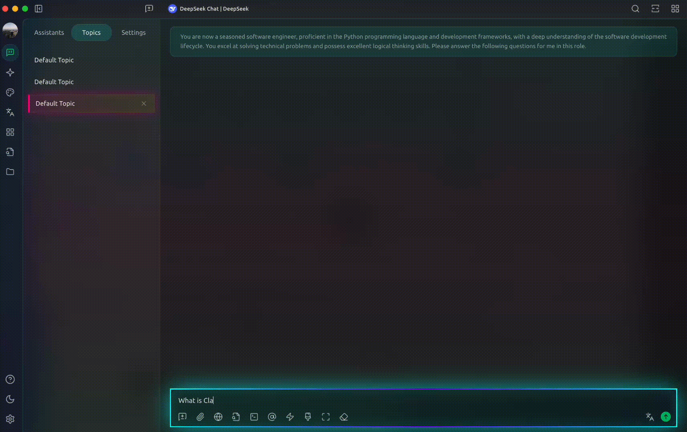
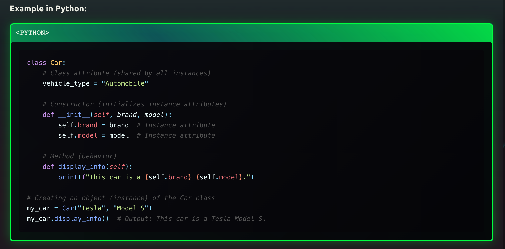
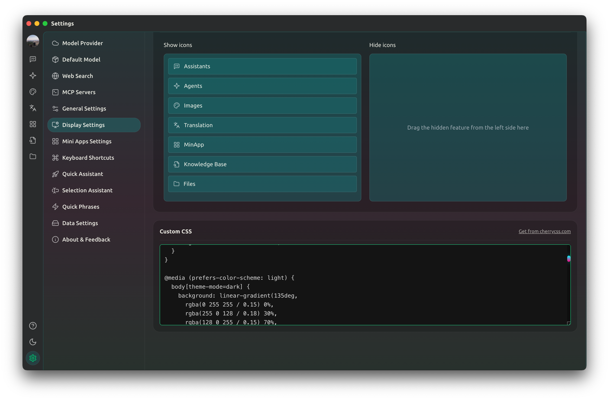

# CherryStudio Cyberpunk Theme 🌈⚡

<div align="center">
<div align="center">
  
</div>

**A stunning cyberpunk-themed CSS for CherryStudio with neon effects**

[English](README.md) | [简体中文](README_CN.md)

</div>

## ✨ Features

- 🎨 **Cyberpunk Aesthetic**: Dark theme with cyan, neon pink, and hacker green
- 🌈 **Neon Effects**: Glowing borders and animated effects
- 💻 **Enhanced Code Blocks**: Special styling with hacker-green borders
- ⚡ **Smooth Animations**: Fluid transitions and hover effects

## 🖼️ Preview

<div align="center">
  
</div>


<div align="center">
  
</div>


<div align="center">
  
</div>


<div align="center">
  
</div>

## 🚀 Installation

1. **Download the CSS file or Copy the code directly**: [cyberpunk-theme.css](cyberpunk-theme.css)

2. **Apply to CherryStudio**:
   - Open CherryStudio
   - Go to Settings → Appearance → Custom CSS
   - Copy and paste the CSS content
   - Thransfer theme to "Dark" mode
   - Save and restart

## 🎨 Customization

You can modify these color variables at the top of the CSS file:

```css
:root {
  --cyber-cyan: #00ffff;
  --cyber-pink: #ff0080;
  --cyber-green: #00ff41;
  /* ... more colors */
}
```

## 🤝 Contributing

Found a bug or want to suggest improvements? Feel free to [open an issue](https://github.com/yourusername/cherrystudio-cyberpunk-theme/issues)!

---

<div align="center">
⭐ Star this repo if you like it!

</div>

