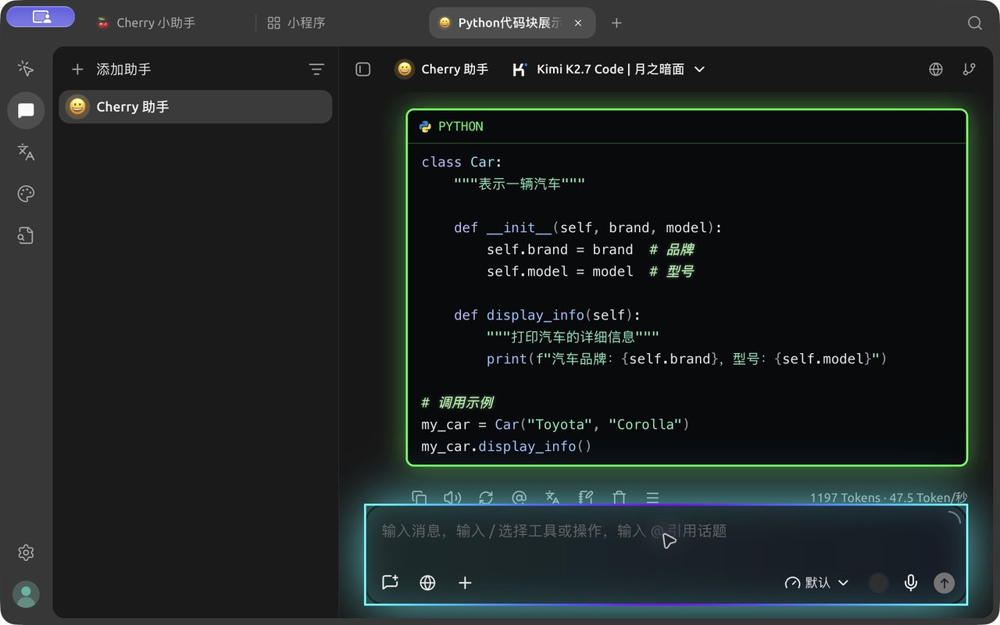
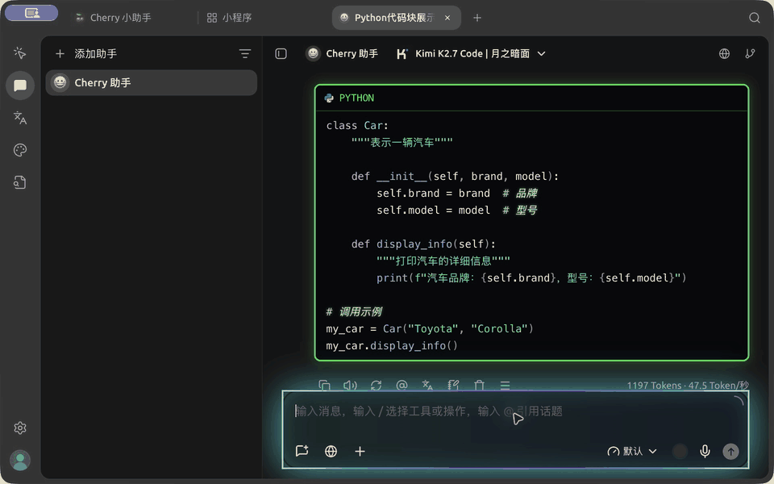
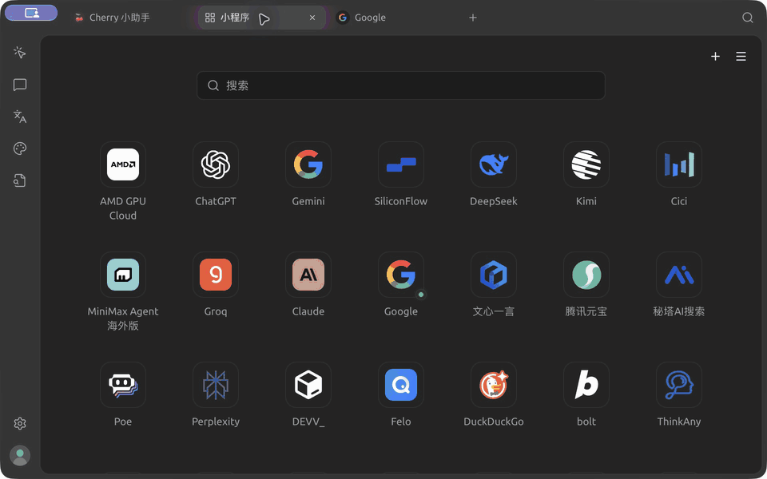

# CherryStudio 赛博朋克主题 🌈⚡

<div align="center">
  
</div>

**为 CherryStudio 打造的炫酷赛博朋克主题**

[English](README.md) | [简体中文](README_CN.md)

## ✨ 特性

- 🎨 **赛博朋克美学**: 深色主题配以青色、霓虹粉和黑客绿
- 🌈 **霓虹效果**: 发光边框和动画效果
- 💻 **代码块增强**: 特殊样式配黑客绿色边框
- ⚡ **流畅动画**: 平滑过渡和悬停效果

## ✅ 支持范围

当前验证版本：**Cherry Studio 2.1.10 · macOS · 深色模式**。

已在实际客户端检查主界面、输入框霓虹动画、模型实际返回的 Python 代码块（含语法高亮与复制）、小程序标签页及双小程序分屏。Windows、Linux 和其他版本尚未完成实机验证；部分组件样式可能随 Cherry Studio 更新而变化。

旧版兼容性不在当前维护范围。历史版本的小程序透明重叠问题（[issue #1](https://github.com/ooRussell63/CherryStudio-CyberPunk/issues/1)）本次不做回补，也不标记为已修复。

## 🖼️ 新版预览

以下素材均录制自 **macOS 上的 Cherry Studio 2.1.10**，使用本仓库 CSS。

**绿色终端代码块与输入框霓虹动画**（真实模型回复）



**小程序标签页与分屏**



小程序网页使用各自网站的外观；主题作用于 Cherry Studio 界面。

## 🚀 安装

1. **下载 CSS 文件或直接复制CSS 代码**: [cyberpunk-theme.css](cyberpunk-theme.css)
2. **应用到 CherryStudio**:
   - 打开 CherryStudio
   - 进入 设置 → 外观 → 自定义 CSS
   - 复制粘贴 CSS 内容
   - 切换主题为“黑暗”模式
   - 自定义 CSS 会自动生效

## 🎨 自定义

您可以修改 CSS 文件顶部的颜色变量：

```css
:root {
  --cyber-cyan: #00ffff;
  --cyber-pink: #ff0080;
  --cyber-green: #00ff41;
  /* ... 更多颜色 */
}
```

## 🙏 致谢与来源

本主题的基础样式大量改编自 [hakadao](https://github.com/hakadao) 的 [CherryStudio-Aero](https://github.com/hakadao/CherryStudio-Aero)，尤其是其 [原始 style.css](https://github.com/hakadao/CherryStudio-Aero/blob/main/style.css)。基础颜色变量、透明背景处理和组件背景规则沿用了该项目的设计并进行了调整，感谢原作者的工作！

本项目在此基础上添加了赛博朋克配色、霓虹效果、动画和代码块样式。CherryStudio-Aero 的许可条款见 [上游许可证](https://github.com/hakadao/CherryStudio-Aero/blob/main/LICENSE)。

## 🤝 贡献

发现问题或想提建议？欢迎 [提交 issue](https://github.com/ooRussell63/CherryStudio-CyberPunk/issues)！

---

喜欢的话请 ⭐ 给个星！
